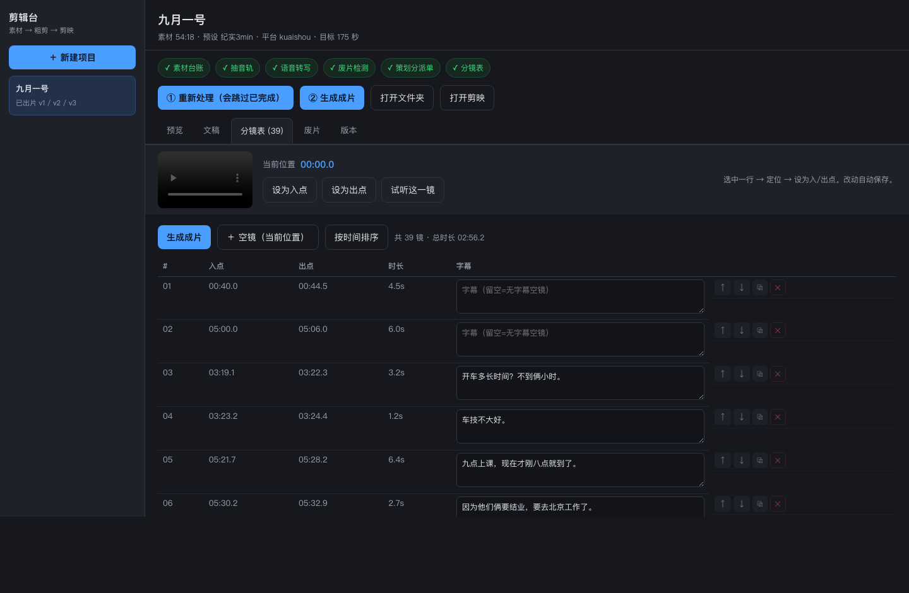

# 视频剪辑 AI 工作流

一套能落地的"素材 → 粗剪 → 剪映工程"流水线，配 3 分钟纪实片的完整案例。

## 有界面了

**双击 `启动剪辑台.command`** → 浏览器打开 → 选素材、点按钮就行。剪辑师不需要碰 JSON 或命令行。
界面说明与维护文档见 **[docs/GUI.md](docs/GUI.md)**；想用命令行见 [docs/SOP.md](docs/SOP.md)。



## 从哪开始看

| 你想知道 | 看这里 |
|---|---|
| 界面怎么用、怎么维护 | **[docs/GUI.md](docs/GUI.md)** |
| 这套东西怎么用、怎么改 | **[docs/SOP.md](docs/SOP.md)** ← 命令行手册 |
| 为什么这么设计、平台怎么打 | [proposal/视频剪辑AI工作流方案.md](proposal/视频剪辑AI工作流方案.md) |
| 剪映草稿格式的坑 | [research/剪映草稿格式调研.md](research/剪映草稿格式调研.md) |
| 抖音/快手 46 项剪辑参数 | [research/抖音快手流量调研.md](research/抖音快手流量调研.md) |
| 成片长什么样 | [projects/2026-09-01_活动/output/v2/preview.mp4](projects/2026-09-01_活动/output/v2/preview.mp4) |
| 这条片子的剪辑思路 | [projects/2026-09-01_活动/README.md](projects/2026-09-01_活动/README.md) |

## 开发环境（uv）

```bash
uv python install 3.12     # 一条命令，不依赖 brew
uv sync --group dev        # 按 uv.lock 建 .venv
uv run python aicut.py list
```

打包（M5）：`./packaging/build_app.sh`（spec 为 `packaging/ai-cut.spec`）。详见 [docs/TECH-STACK.md](docs/TECH-STACK.md)。

## 四条命令

```bash
cd ~/Documents/deepseek-harness/default-workspace

python3 aicut.py new 项目名 --material ~/Movies/xxx.MOV --preset 纪实3min
python3 aicut.py run 项目名          # 转写 → 切片 → 废片表 → 策划分派单
python3 aicut.py status 项目名        # 看进度
python3 aicut.py build 项目名 --version v2   # 改完 shots.json 后重出
```

## 目录

```
启动剪辑台.command    双击启动图形界面
gui/                  界面：server.py（本地服务）+ static/index.html（单页）
aicut.py              入口（new / run / status / build / list）
presets/              风格预设：纪实3min、口播60s、探店45s、切片30s
pipeline/             底层：切片、渲染、剪映草稿生成、转写整理、废片检测
research/             调研 + 草稿校验器 validate_draft.py
projects/<项目>/       project.json（配置）+ shots.json（分镜表）+ work/ + output/v1 v2…
docs/SOP.md           操作手册
```

## 核心设计

1. **分镜表是唯一可调层**：`shots.json` 里每条镜头就四个字段（in/out/sub/note），改完只重出，不重跑转写。
2. **镜头缓存**：`work/clips/` 按入出点做 key，改一句字幕不会重切任何镜头（实测无改动重跑 2.6 秒）。
3. **两条出口同源**：同一份 `timeline.json` 同时生成 `preview.mp4` 和剪映工程，不会出现"预览和工程不一样"。
4. **版本不覆盖**：`output/v1 v2 v3`，剪映草稿同名带版本号，随时能回到上一版。
5. **草稿有门禁**：每次生成后跑 `validate_draft.py`，FAIL 就不交付。
